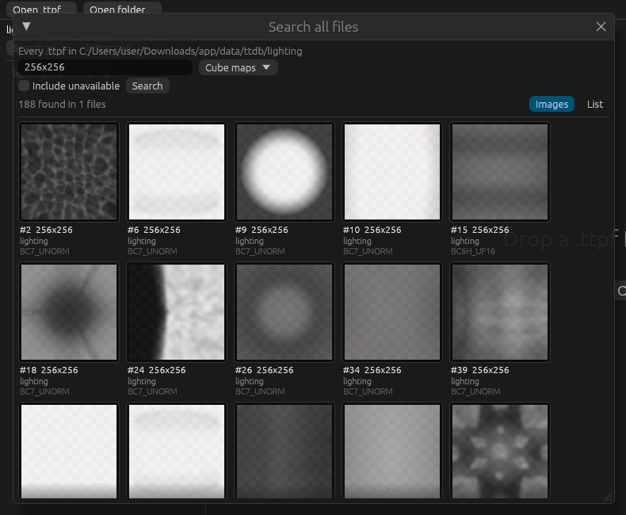
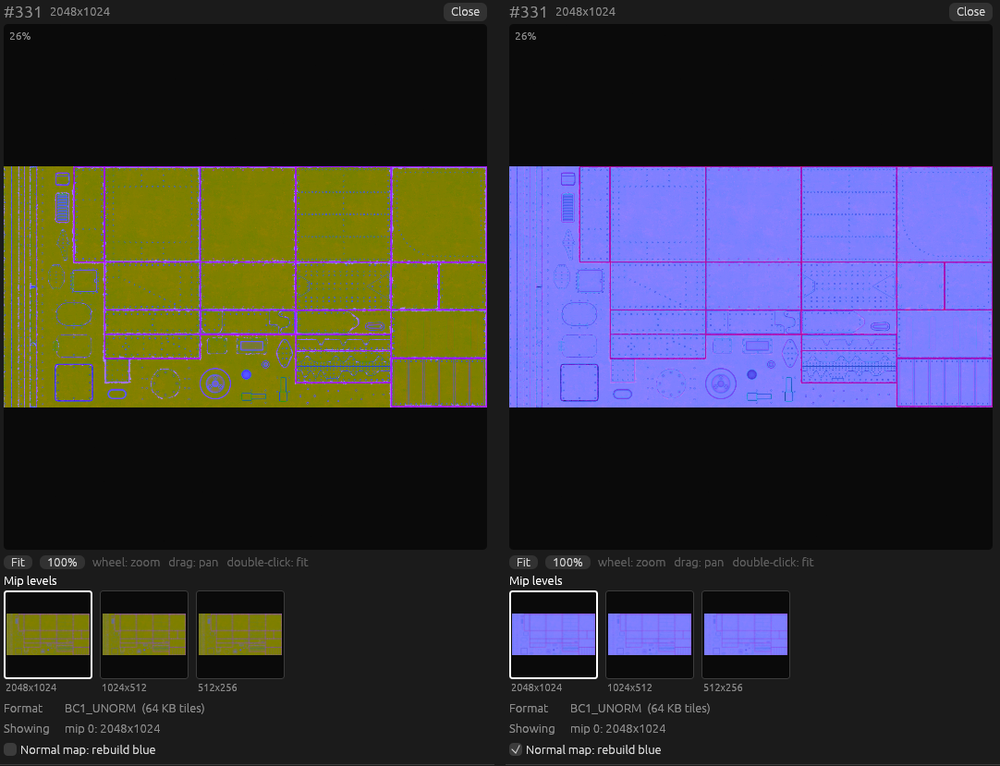
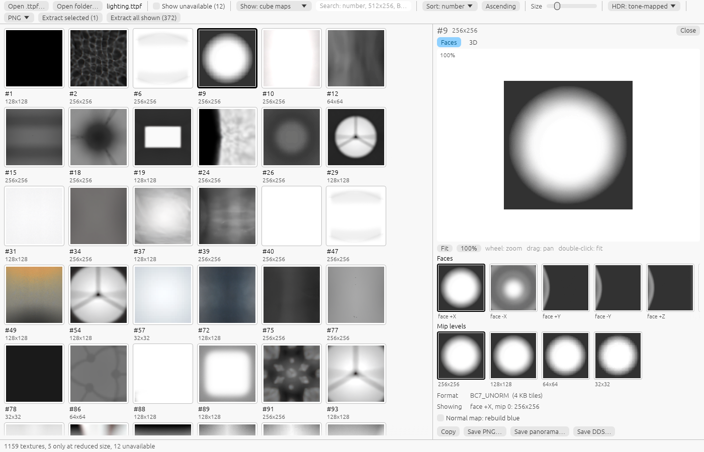

# TTPF Viewer

A viewer and extractor for Xbox Series and PS5 `.ttpf` texture archives. Drop a file in and browse
thousands of textures at once, look at any of them up close, and save them as PNG or DDS.


- **Automatic platform detection** for Xbox RDS5 and PS5 standalone ETPF, with platform-specific 64 KiB tile layouts
- **All common formats**: BC1 to BC7, HDR (BC6H, half-float) and uncompressed
- **Cube maps and texture arrays**, with a 3D view and 360° panorama export
- **Export** as PNG, or as DDS with the decoded BC blocks, HDR values and mip levels
- **Whole folders**: browse them in a sidebar, search every archive at once, extract everything in one go
- **Fast**: multi-gigabyte archives open instantly; textures are only unpacked when shown

## Download

Get `ttpf-viewer-windows-x64.exe` from the [Releases](../../releases) page. It's a single file with nothing to
install. On Linux or macOS, [build it from source](#building-from-source).

## Quick start

1. Drag a `.ttpf` onto the window (or click **Open .ttpf…**). To browse a whole folder, drag the folder in
   instead, or use **Open folder…**.
2. Click a texture to see it large, with its mip levels underneath.
3. Select textures and click **Extract selected**, or **Extract all shown**. They're saved as `<number>.png`
   in a folder named after the archive.

## Finding textures

- **Search** by texture number, size (`512x256`) or format (`BC7`).
- **Show** only cube maps, texture arrays, HDR textures, ones readable only at a smaller size, or unavailable ones.
- **Sort** by number, size or format, ascending or descending.
- With a folder open, **Search all…** searches every `.ttpf` in it and shows the results as pictures or a list.
  Click one to open it.



## Looking at a texture

- Mouse wheel zooms, drag pans, double-click fits. Click a mip level under the image to view it.
- **Cube maps** show their six faces. Switch to **3D** to look around inside the cube map like a sky, or see it
  wrapped on a **Sphere**: drag to turn, wheel to zoom. **Up: Z / Y** sets which way is up (Z for RAGE games).
- **Texture arrays** show their slices. Click one to view it.
- **HDR textures** (BC6H, half-float) are tone-mapped so bright parts keep their detail. Choose **HDR: clipped**
  in the toolbar to see the stored values instead.
- **Normal maps** that store only X and Y (in red and green) use blue for other data, so they look olive.
  Tick **Normal map: rebuild blue** to see them as normal maps; untick it to go back. The archives don't mark
  which textures are normal maps, so this is never done automatically. (BC5 normal maps always get blue rebuilt.)



The app follows your system's light or dark theme:



## Saving

| | |
|---|---|
| **PNG** | what you see, as `<number>.png` |
| **DDS** | the decoded blocks or texels, including HDR values and mip levels. Choose **DDS** next to the Extract buttons, or **Save DDS…** for one texture |
| **Panorama** | a cube map as one 360° picture (2:1), the format sky viewers and 3D programs use |
| **Copy** | right-click a texture, or **Copy** under the preview, to put it on the clipboard |
| **Whole folder** | **Extract all…** in the folder sidebar: every archive into its own folder |

Cube maps are saved as one PNG per face (`<number>_px.png`, `_nx`, `_py`, `_ny`, `_pz`, `_nz`) and texture
arrays as one per slice (`<number>_0.png`, `_1`, …). In DDS, all faces or slices go in one file.

Settings (sort, filter, thumbnail size, HDR, PNG/DDS, 3D up axis and the open folder) are remembered between runs.

## Keys and mouse

| | |
|---|---|
| Click | select and preview |
| Ctrl+click / Shift+click | add to the selection / select a range |
| Ctrl+A | select everything shown |
| Arrow keys | move through the gallery |
| Esc | clear the selection and close the preview |
| Right-click | copy, save PNG, DDS or panorama |

## Texture support

The viewer reads BC1, BC2, BC3, BC4, BC5, BC6H (unsigned and signed), BC7, R8, A8, R16_FLOAT, RGBA8, BGRA8 and RGBA16 (UNORM and FLOAT). Xbox BCPack covers BC1, BC3, BC4, BC5, BC6H and BC7. Block reconstruction and its verification are described in the [Xbox notes](docs/xbox.md).

A partly downloaded archive may still contain smaller mips. The viewer shows the largest available level and its dimensions. **Show unavailable** also lists entries with missing data, unsupported formats or unknown layouts.

## Command line

```
ttpf-viewer FILE.ttpf                      open a file in the app
ttpf-viewer DIR                            browse an installation folder
ttpf-viewer extract FILE.ttpf OUTDIR       save every readable texture as OUTDIR/<number>.png
ttpf-viewer extract-folder DIR OUTDIR      the same for every .ttpf under DIR, one folder per file
ttpf-viewer panorama FILE.ttpf N OUT.png   save cube map #N as a 360° panorama
ttpf-viewer list FILE.ttpf                 print the textures in the file
```

Options: `--dds` saves DDS instead of PNG, `--clip` clips HDR textures instead of tone-mapping them, and `--y-up`
(for `panorama`) treats Y as up.

## Format notes

Open **Format notes** in the toolbar. **Both** shows the shared descriptor layout and both platform sections. **Xbox** and **PS5** show the shared layout and the selected platform's storage details. The same text is available here.

| Both platforms | Xbox | PS5 |
| --- | --- | --- |
| [ETPF descriptors, mip levels and exports](docs/shared.md) | [RDS5 chunks, BCPack codecs and reconstruction](docs/xbox.md) | [Direct ETPF, alignment and GPU tiles](docs/ps5.md) |

## Building from source

Install Rust from [rustup.rs](https://rustup.rs), then:

```
cargo build --release
```

The program is `target/release/ttpf-viewer` (`.exe` on Windows). On Linux you also need the GTK3 and
xkbcommon development packages (`sudo apt install libgtk-3-dev libxkbcommon-dev`).

For development, `TTPF_VIEWER_TEST="out.png;select=12,level=1,light"` makes the app open the given file, apply
the actions, save a screenshot of its own window to `out.png` and quit.

Run `cargo test --release --locked` for self-contained tests. To check local installations, set `TTPF_XBOX_ROOT` and `TTPF_PS5_ROOT` and run `cargo test --release --locked -- --ignored --nocapture`. The install tests read both directories, compare selected previews and complete DDS payloads, and decode every Xbox BCPack chunk. The full comparison requires matching game builds.

## Credits

- [egui / eframe](https://github.com/emilk/egui) for the interface
- [texture2ddecoder](https://github.com/UniversalGameExtraction/texture2ddecoder) for BCn decoding;
  `src/bc6h.rs` is its BC6H decoder adapted to keep HDR values (MIT, notice in the file)
- [arboard](https://github.com/1Password/arboard), [rfd](https://github.com/PolyMeilex/rfd),
  [image](https://github.com/image-rs/image), [flate2](https://github.com/rust-lang/flate2-rs),
  [rayon](https://github.com/rayon-rs/rayon) and [memmap2](https://github.com/RazrFalcon/memmap2-rs)
- [Percy6Stars](https://github.com/Ahmet-Dedeler/Percy6Stars) and [PercyStar](https://github.com/rpatty-dev/PercyStar)
  (by rpatty-dev), whose research showed how the block table encodes block ends and storage types, and
  [GTA6-Asset-Info](https://github.com/TrinitronClient/GTA6-Asset-Info) for the descriptor fields and the cube map
  and array layouts.
- This repository includes VIctory’s Xbox BCPack decoder and fixed format tables. Cargo builds the decoder from the local source and embeds the table in the executable. [Vendored decoder and tables](vendor/victory-bcpack) · [Upstream revision and license notice](vendor/victory-bcpack/NOTICE)
- SixNG supplies the 3D volume layout and the BC6H field layouts used to verify the decoder. The tests use the bcpack-rs encoder to generate streams and its decoder for independent BC3, BC4, BC5 and BC7 comparisons. [SixNG](https://github.com/holdmysocks/SixNG) · [bcpack-rs](https://github.com/Ahmet-Dedeler/bcpack-rs)
- [ttpf-spec](https://github.com/BaptistSec/ttpf-spec/blob/main/SPEC.md) compares community RDS5 and ETPF field descriptions. The [reverse-engineering index](https://github.com/Ahmet-Dedeler/awesome-gta6-reverse-engineering) links the related format research.

## License

The original viewer source retains its [MIT license](LICENSE). The combined executable links SixNG and the vendored VIctory decoder and uses [GPL-3.0-only](COPYING) for its code. bcpack-rs is available under MIT or Apache-2.0. VIctory excludes the BCPack table data from its source license. [Vendored license notice](vendor/victory-bcpack/NOTICE)
