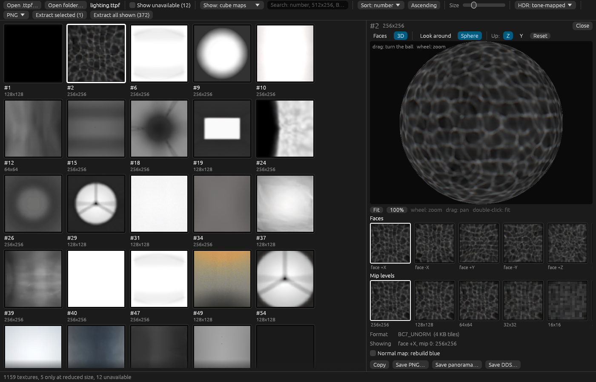

# TTPF Viewer

Browse and extract the textures inside `.ttpf` texture archives.

Drop a `.ttpf` onto the window and every texture appears in a gallery, decoded exactly as the archive's header
describes it: format, size, GPU tile layout and mip levels. Click one to see it large with all its mip levels,
save it as PNG, or extract a whole selection at once.



## Download

Grab `ttpf-viewer-windows-x64.exe` from the [Releases](../../releases) page. It's a single file, nothing to install.
(Linux and macOS: build from source, see below.)

## Using it

| | |
|---|---|
| Open a file | drag it onto the window, click **Open .ttpf…**, or `ttpf-viewer FILE.ttpf` |
| Browse a folder | **Open folder…** (or drop a folder): its `.ttpf` files appear in a sidebar; click one to open it. **Search all…** finds textures in every file of the folder, shown as pictures or a list (click one to jump to it); **Extract all…** saves every file's textures, one folder per file |
| Select | click; **Ctrl**+click to add; **Shift**+click for a range; **Ctrl+A** all; arrow keys to move |
| Preview | mouse wheel zooms, drag pans, double-click fits; click a mip level below the image to view it |
| Extract | **Extract selected** or **Extract all shown**: `<number>.png` files go into a folder named after the archive. Pick **DDS** next to the buttons (or **Save DDS…** for one texture) to get the original data instead: lossless, with its BCn compression, HDR values and mip levels |
| Find | search by texture number, size (`512x256`) or format (`BC7`); **Show** only cube maps, texture arrays, HDR, smaller-size-only or unavailable textures; sort by number, size or format, ascending or descending |
| Copy | right-click a texture (or **Copy** under the preview) to put it on the clipboard; the right-click menu also saves PNG, DDS or a panorama |
| Cube maps, arrays | pick a face or slice in the strip under the preview; for cube maps, **3D** shows it from inside (**Look around**, like a sky) or wrapped on a **Sphere**: drag to turn, wheel to zoom, **Up: Z/Y** picks the world's up axis (Z for RAGE games). **Save panorama…** saves the whole cube map as one 360° picture (2:1), the format sky viewers and 3D programs use. Extracting saves one PNG per face (`<number>_px.png`, `_nx`, `_py`, `_ny`, `_pz`, `_nz`) or slice (`<number>_0.png`, …); DDS keeps them all in one file |
| Normal maps | some normal maps keep only X and Y (red and green) and use blue for other data, so they look olive; tick **Normal map: rebuild blue** under the preview to see blue as the Z they imply (untick to go back). The files don't say which textures are normal maps, so this is never automatic. It affects the preview, Copy, Save PNG and Extract; DDS keeps the original data |
| HDR | BC6H and half-float textures are tone-mapped so bright parts keep their detail; switch to **clipped** in the toolbar to see values as stored (`--clip` on the command line) |

Archives open instantly, even multi-gigabyte ones: only the header is read up front, and texture data is
unpacked when it is shown or exported. Settings (sort, filter, thumbnail size, HDR, PNG/DDS, 3D up axis, the open folder)
are remembered between runs.

### What it can't show

- **Unsupported compression**: some blocks in these archives are stored with BCPack, the Xbox hardware texture
  compression, which has no public decoder. If only a texture's full-size level is stored that way,
  the largest readable mip level is shown instead, marked "only WxH". Otherwise the texture is listed under
  **Show unavailable**.
- **Cut off**: parts missing from a partially downloaded archive.
- **Unsupported format**: any DXGI format not listed below.

Supported formats: BC1, BC2, BC3, BC4, BC5 (blue rebuilt from red and green, as for normal maps), BC6H (unsigned
and signed), BC7, R8, A8,
R16_FLOAT (shown as grey scaled to its own range, e.g. heightmaps), R8G8B8A8, B8G8R8A8, R16G16B16A16.

### Command line

```
ttpf-viewer extract FILE.ttpf OUTDIR   save every readable texture as OUTDIR/<number>.png (--dds: as .dds)
ttpf-viewer extract-folder DIR OUTDIR  the same for every .ttpf under DIR, one folder per file (--dds)
ttpf-viewer panorama FILE.ttpf N OUT.png   save cube map #N as a 360° panorama (--y-up if Y is up)
ttpf-viewer list FILE.ttpf             print the textures in the file
```
`--clip` shows HDR textures clipped instead of tone-mapped.

## The format

```text
0x00  "RDS5"
0x04  u32  number of blocks
0x08  u32  total size of the unpacked data (low 32 bits; bits 32-39 are in the low byte of 0x0C)
0x10  u32  position of the ETPF section / 256
0x18  u64 per block:  bits  0-25  where the block ends in the file / 256
                      bits 26-29  how the NEXT block is stored: 0 = as-is, 1-7 = BCPack, 8 = zlib
                      bits 30-51  where the block ends in the unpacked data / 4096
      (the first block starts at the ETPF position and holds the ETPF section, stored as-is)
then, at the ETPF position:
      "ETPF", u32 ?, u32 number of textures, u32 section size
      16 bytes per texture:
        dword0  bits  0-13 width-1, 14-27 height-1
        dword1  bits  0-9  DXGI format << 3 | flags, bits 10-19 array size - 1,
                bits 24-27 tile mode (0 = 64 KB tiles, 1-3 = 4 KB, 9-12 = 4 KB cube maps)
        dword2  bits  0-20 start of the texture in the unpacked data / 4096
      then a sorted list of 8-byte name hashes
```

Mip levels follow AMD's Gfx10 layout: smallest first, each in whole tiles, except that the smallest levels share
one "mip tail" tile at fixed spots ([`src/layout.rs`](src/layout.rs)). Texture arrays store level by level, each
level's slices back to back; cube maps (tile modes 9-12) store tile mode - 8 complete cubes of growing size, the
full-size one last.

The blocks are consecutive chunks of one unpacked stream. Each texture is a contiguous run of that stream
holding its mip levels smallest first; the full-size level ends where the next texture starts. Pixel data is
stored in AMD's standard tile order; the tile patterns are in [`src/tile.rs`](src/tile.rs).

## Building from source

Install Rust from [rustup.rs](https://rustup.rs), then:

```
cargo build --release
```

The program is `target/release/ttpf-viewer` (`.exe` on Windows). On Linux you also need the GTK3 and
xkbcommon development packages (`sudo apt install libgtk-3-dev libxkbcommon-dev`).

For development, `TTPF_VIEWER_TEST="out.png;select=12,level=1,light"` makes the app load the given file,
apply the actions, save its own rendered window to `out.png` and quit.

## Credits

- [egui / eframe](https://github.com/emilk/egui) for the interface
- [texture2ddecoder](https://github.com/UniversalGameExtraction/texture2ddecoder) for BCn decoding; `src/bc6h.rs` is its BC6H decoder
  adapted to keep HDR values (MIT, notice in the file)
- [arboard](https://github.com/1Password/arboard) for the clipboard, [rfd](https://github.com/PolyMeilex/rfd), [image](https://github.com/image-rs/image), [flate2](https://github.com/rust-lang/flate2-rs), [rayon](https://github.com/rayon-rs/rayon), [memmap2](https://github.com/RazrFalcon/memmap2-rs)

- [Percy6Stars](https://github.com/Ahmet-Dedeler/Percy6Stars) and [PercyStar](https://github.com/rpatty-dev/PercyStar) (by rpatty-dev),
  whose research showed how the block table encodes block ends and storage types, and
  [GTA6-Asset-Info](https://github.com/TrinitronClient/GTA6-Asset-Info) for the descriptor fields; this app's code is its own

## License

MIT, see [LICENSE](LICENSE).
